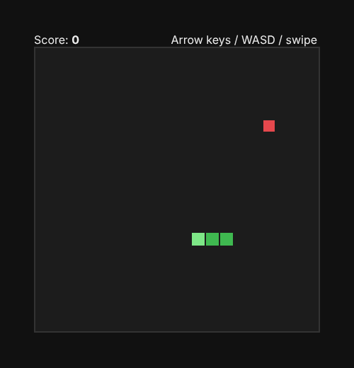

# How Good? Claude Code vs. Claude chat, for apps and games

This repo holds a working demo built entirely by Claude Code: [`snake/`](snake/).

## What happened when it was built

| Step | Chat | Claude Code |
|---|---|---|
| Write the files | Pastes code; you copy it into files | Created `game.js`, `main.js`, `index.html`, tests and `package.json` directly |
| Run the tests | You run them and paste back errors | Ran `npm test`, saw a failure (a wrong test path), fixed it, reran |
| Check the tests catch bugs | Not possible | Put in a real bug (snake U-turns into itself after two quick key presses), confirmed a test failed, then reverted it |
| Check the game works | You open it and describe what you see | Opened it in a headless browser, pressed keys, took a screenshot, checked for console errors |
| Save the work | You commit | Committed and pushed to GitHub |



## Run it

```bash
npm test                      # 7 unit tests for the game logic
python3 -m http.server 8000   # then open http://localhost:8000/snake/
```

## Things to try asking Claude Code for

**Games**
- "Add a high score saved in localStorage, and a test for it."
- "The game feels laggy on my phone. Profile it and fix it."
- "Add a level system where speed increases every 5 food. Play it in the browser to check it's beatable."
- "Port this to Phaser / Godot / Unity C#." (It reads the whole project, not just one file you pasted.)

**Apps**
- "Add login with Supabase, then run the app and click through sign-up to check it works."
- "Here's an error from my console: `...`. Find the cause and fix it." (It searches the codebase itself.)
- "Rename `User` to `Account` everywhere." (A change across many files at once.)
- "Write tests for the checkout flow and fix anything they find."
- "Set up GitHub Actions so tests run on every push."

## Why it's better for real projects

1. **It sees your whole project**, not just the snippet you pasted.
2. **It runs things**: tests, builds, servers, browsers. It checks its own work instead of guessing.
3. **It fixes its own mistakes** because it sees the actual error output.
4. **It edits files in place**, so you don't copy and paste between windows.
5. **It uses git**: every change can be committed, reviewed, and undone.

Chat is still great for brainstorming game ideas, design questions, and learning concepts.
