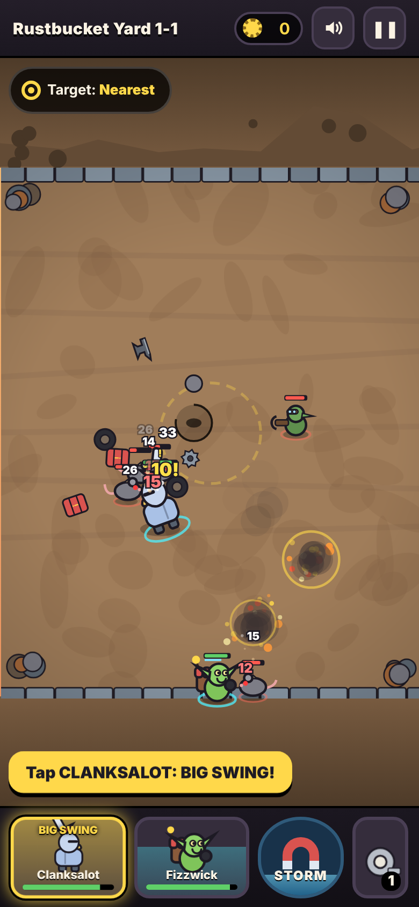
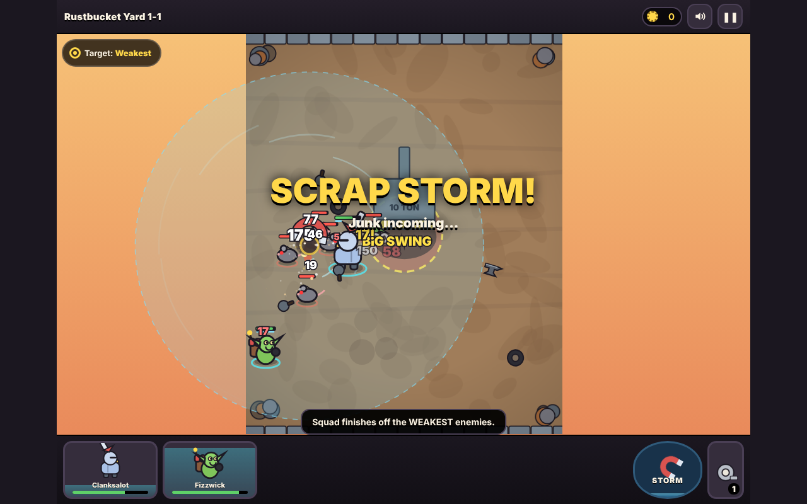
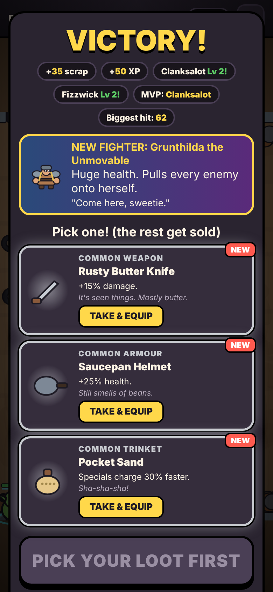

# SCRAPBOUND: LOOT RIOT

Chaotic auto-battles in a fantasy junkyard. Your squad fights on its own, and you make the big calls: fire specials, unleash the **Magnetic Scrap Storm**, and choose your loot.

| Battle (phone) | Scrap Storm (desktop) | Loot (phone) |
|---|---|---|
|  |  |  |

## Play

**Locally:** double-click `scrapbound/index.html`. No install, server or internet needed.

**Controls**

| Action | Touch / mouse | Keyboard |
|---|---|---|
| Fighter special (when the portrait glows) | Tap the portrait | `1` `2` `3` |
| Scrap Storm (when the magnet is full) | Tap STORM | `Space` |
| Use packed item | Tap the item button | `Q` |
| Change who the squad targets | Tap "Target" | `T` |
| Pause / restart / settings | ❚❚ button | `P` or `Esc` |
| Mute | Speaker button | `M` |

**Tanks:** Clanksalot, Grunthilda and Tusker have armour and guard nearby allies. Keep your damage dealers close to them.

**What's in it:** 8 fighters, 6 enemy types plus elites, 3 bosses, 3 arenas with hazards, 15 campaign stages, endless Riot Mode, 24 items in 6 rarities, 3 consumables, 10 secret synergies, a secret encounter, and the Heap home base. Progress saves automatically in your browser.

## Publish on GitHub Pages

1. Get the code onto your default branch (`main`): merge this branch through a pull request on GitHub.
2. On GitHub, open the repo, then **Settings → Pages**.
3. Under **Build and deployment**, set **Source** to **Deploy from a branch**, choose **`main`** and **`/ (root)`**, then click **Save**.
4. Wait about a minute, then refresh the Pages settings. GitHub shows the live URL there. It will be `https://<your-username>.github.io/<repo-name>/`. The root page sends visitors straight into the game at `.../scrapbound/`.

Nothing needs building: it's plain HTML, CSS and JavaScript.

## Tests

From the repository root (requires Node 18+):

```bash
npm test             # 48 game-logic tests (plus the Snake demo's 7)
npm run test:e2e     # 27 browser checks on desktop + phone sizes (needs Playwright + Chromium)
npm run balance      # plays the campaign 10x with an auto-pilot and prints win/loss per stage
node scrapbound/tools/balance.mjs 10 human   # same, but reacting at human speed
node scrapbound/tools/feel.mjs 20            # opening punch + tank metrics per fight
node scrapbound/tools/items.mjs 30   # measures each item's real impact on fights
```

If Playwright isn't installed, run `npm i -D playwright && npx playwright install chromium` first. Browser tests save screenshots to `scrapbound/test/screenshots/`.

## How it's built

| File | What it does |
|---|---|
| `js/data.js` | All content: fighters, enemies, items, arenas, stages, synergies |
| `js/sim.js` | Combat simulation. Pure logic, deterministic per seed, no drawing |
| `js/progress.js` | Save data, rewards, loot rolls, equipment, unlocks, the Heap |
| `js/render.js` | Procedural cartoon art on a canvas, particles, effects |
| `js/audio.js` | Synthesized sound effects and music (Web Audio, no files) |
| `js/main.js` | Screens, input, game loop |
| `test/logic.test.js` | Unit tests for the sim and progression |
| `test/e2e.mjs` | Browser tests driving the real UI |
| `tools/` | Balance and item-impact simulators |

The files are classic scripts sharing a global `SB` namespace (not ES modules), so the game works when opened straight from disk. The same files load in Node for testing.

Difficulty knobs live in `SB.TUNING` (in `sim.js`). Try `SB_TUNING='{"enemyHp":2.5}' npm run balance` to preview a change before you make it.

## Known limitations

- **Sound is untested by ear.** The audio code runs without errors in tests, but no one has listened to it in this environment. Music is on by default and can be turned off in camp or pause.
- **Not tested on real phones.** Phone layouts were tested in Chromium's phone emulation (390×844 portrait and 844×390 landscape, touch enabled). Real Safari on iOS and Firefox have not been run.
- **Low-end performance:** about 59 fps in a busy fight on a normal machine. A 4x CPU-throttled software-rendering test reached about 20 fps; real phones draw with a GPU and should do better, but very old devices may stutter. The game lowers its resolution automatically if frames get slow.
- **Leaving mid-battle forfeits that battle** (no rewards, no penalty). Loot you haven't picked yet is saved and waits for you.
- **Balance** was tuned with a simulated human-speed player (reacting 2–4s late). Real people vary: check the numbers after friends play. The campaign takes roughly 15–25 minutes.
- **"Fun" is measured with proxies** (time to first special, kills in the first 20s, win rates, who takes damage). They are not real playtests.
- Saves live in your browser's local storage, so they don't move between devices or browsers, and clearing site data erases them.
